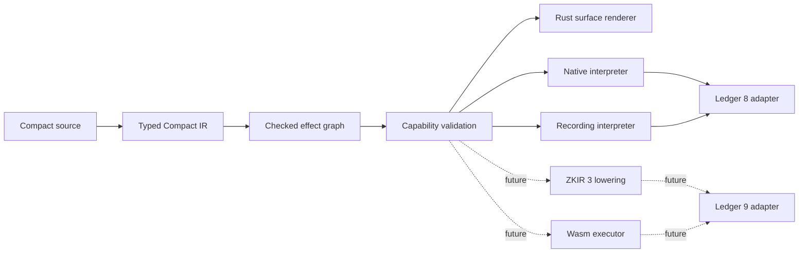

# Proposed 0.4.0 scope: functional Rust over Ledger 8, prepared for Ledger 9

**Status:** proposed scope; requires maintainer review and issue/ADR decomposition  
**Implementation baseline:** `codex/recording-effect-prototype` at `ab132650`  
**Execution baseline:** Ledger 8, private Rust IR 20, runtime ABI 52  
**Non-claim:** this document does not implement, qualify or advertise Ledger 9 support

## Decision in one sentence

Use Ledger 8 to prove an immutable, Aiken-inspired generated Rust surface over the
existing checked effect plan, while keeping the semantic graph independent of the
Ledger 8 adapter and reserving explicit capability boundaries for Ledger 9.

This is a renderer and domain-model evolution, not a new source language. Compact
remains the authored contract language. Generated Rust should become readable
enough to review, debug and embed without becoming a second hand-written contract
language whose semantics can drift from Compact.

## Why Ledger 8 is the correct first proving ground

Ledger 8 already has the strongest comparison assets in this branch: generated
TypeScript behavior, native Rust execution, recorded execution, proof fixtures,
ledger application fixtures and gas observations. A new surface can therefore be
tested against accepted behavior instead of being developed concurrently with a
new ledger protocol.

The branch already contains most of the semantic foundation:

- `recorded/effect_plan/model.rs` represents typed SSA values and ordered blocks;
- lowering separates Compact IR recognition from Rust syntax;
- validation checks declarations, types, use-before-definition and branch joins;
- rendering is downstream of the checked plan;
- `CircuitFrame` and `RecordingFrame` own context threading, accumulated gas and
  private outputs.

The current problem is consequently narrower than introducing an effect system.
Generated bodies still expose compiler temporaries and frame/value tuples:

```rust
let (frame, __compact_effect_3): (_, STATE) =
    ledger_slots::state.record_read(frame)?;
let __compact_effect_4 = __compact_effect_3 == STATE::unset;
if !__compact_effect_4 {
    return Err(CompactError::AssertionFailed(message));
}
let frame = ledger_slots::value.record_write(frame, value)?;
Ok(frame.finish(()))
```

This is immutable and correct, but it reads like serialized SSA rather than a
contract rule.

## Intended generated surface

The target style borrows Aiken's emphasis on typed values, explicit predicates,
linear reading order and visible effects. It uses ordinary Rust types and methods,
not a body-wide procedural macro.

An illustrative target—not a committed API spelling—is:

```rust
pub fn set<Private, W: TryWitnesses<Private>>(
    context: CircuitContext<Private>,
    witnesses: &W,
    value: Field,
) -> Result<RecordedCircuitResult<Private, ()>, CompactError> {
    Contract::record(context)
        .read(ledger::state)
        .require(|state| state == STATE::unset, errors::already_set)
        .witness(|cx| witnesses.private_secret_key(cx))
        .map(pure::public_key)
        .write(ledger::authority)
        .then(ledger::value.write(value))
        .then(ledger::state.write(STATE::set))
        .returning(())
}
```

The exact renderer may choose named local values where a fluent chain would harm
diagnostics or compile time:

```rust
let program = Contract::record(context);
let (program, state) = program.read(ledger::state)?;
let program = program.require(state == STATE::unset, errors::already_set)?;
let (program, secret) = program.witness(witnesses::private_secret_key)?;
let authority = pure::public_key(secret)?;
program
    .write(ledger::authority, authority)?
    .write(ledger::value, value)?
    .write(ledger::state, STATE::set)?
    .returning(())
```

Both forms satisfy the actual objective:

- no generated `mut context`;
- no generated `total_cost` bookkeeping;
- no public `step.context` extraction;
- effect order remains visually explicit;
- values have source-derived names where available;
- failures use typed or stable generated error identifiers;
- generated Rust stays inspectable by rustfmt, Clippy and IDE tooling.

The milestone should select one spelling only after measuring generated size,
compiler time, diagnostic quality and branch/callee ergonomics on real contracts.

## Domain model

The existing effect plan remains the semantic authority. The public/runtime
vocabulary should project it into a smaller set of concepts:



### Core values

```text
Value<T, Visibility>  typed symbolic or materialized value
Rule                  pure Boolean proposition with source provenance
Circuit<T, Effects>   ordered, fallible computation returning T
Constructor<T>        deployment-only computation returning T
ContractRef<I>        address plus statically known contract interface I
Target<Caps>          selected backend/ledger capability set
```

`Visibility` starts with the distinctions that can be proved on Ledger 8:

```text
Private | Disclosed | Public
```

It must not claim that a Rust marker alone proves zero-knowledge secrecy. The
marker records compiler provenance and controls permitted operations; proof and
disclosure behavior remain properties of lowering and qualification.

### Effect nodes

The stable graph vocabulary for this milestone is:

```text
Pure
Require
Witness
LedgerRead
LedgerImpact
LocalCall
Zswap
Select
BoundedLoop
Return
```

`LedgerImpact` deliberately represents operations such as Set insertion, Map
removal, Counter increment and Merkle insertion as first-class operations. It
must not normalize them into read/modify/write, because that can change conflict,
proof and gas semantics.

The following nodes are reserved in the versioned graph vocabulary but are not
Ledger 8 capabilities:

```text
ContractCall
Emit
VerifyProof
```

A Ledger 8 target must reject a reachable reserved node during target capability
validation with its Compact source location. It must never silently erase the
node, reinterpret it as a local call or defer failure to generated Rust.

### Capability sets

Capabilities are data attached to targets, not conditionals distributed through
the renderer:

```rust
pub trait TargetCapabilities {
    const CONTRACT_CALLS: bool;
    const EVENTS: bool;
    const IN_CIRCUIT_PROOF_VERIFY: bool;
    const ZKIR_MAJOR: u8;
    const CRYPTO_SUITES: &'static [CryptoSuite];
}
```

This snippet describes the direction, not a required use of associated constants.
A serializable manifest may be a better source of truth. The invariant is that
one pre-render validation pass owns target admission and diagnostics.

### Functional laws

The Aiken-inspired surface is useful only if its operators have stable laws.
The Ledger 8 implementation must exercise these laws over finite generated and
real-contract cases:

```text
return(x).map(f)              == return(f(x))
return(x).and_then(f)         == f(x)
p.and_then(return)            == p
p.then(return(()))            == p, for Unit sequencing
require(true, e).then(p)      == p
require(false, e).then(p)     == error(e), with no effects from p
select(true, a, b)            == a, with no effects from b
select(false, a, b)           == b, with no effects from a
```

The equalities are observational: result or error, ledger state, private state,
ordered public effects, private outputs and gas must agree. Reassociation is not
permitted across an effect whose failure or metering order would change. Both
branches remain statically checked even though only one branch executes.

### Rust domain rules

The scope turns the proposed Rust advantages into concrete constraints:

| Rust strength | Required use in this model |
| --- | --- |
| Validated newtypes | fields, scalars, points, addresses, artifact hashes and entry-point identifiers cannot be constructed from unchecked bytes through the ordinary API |
| Exhaustive enums | crypto suites, targets, graph nodes, visibility states and structured errors have no catch-all semantic variant |
| Explicit ownership | a program/frame is consumed once; context, gas and private outputs cannot be duplicated or adopted twice |
| Deterministic numerics | widths, overflow/modular behavior and conversions are explicit in graph types and target validation |
| Trait/capability checking | target and operation availability are checked centrally; traits must not become an implicit fallback mechanism |
| Typed target APIs | Ledger 8, Ledger 9, native, recording, ZKIR and Wasm adapters expose only qualified operations |
| Few implicit coercions | cross-width, cross-field and byte/domain conversions are explicit nodes with source provenance |
| Canonical serialization | graph, interfaces and manifests use a versioned canonical encoding; `serde` layout alone is not protocol identity |
| Shared native crypto | adapters use reviewed domain crates behind validated types; Wasm substitutions require separate qualification |
| Clear error types | invalid source/graph, unsupported target, execution failure, preparation failure, proof failure and application failure remain distinct |
| Cheaper execution | abstraction cost is measured; ergonomics cannot add ledger queries, transcript operations or unbounded allocation |

These rules prevent the functional surface from becoming a chain of loosely typed
callbacks. The graph remains inspectable data, and each interpreter remains an
explicit implementation of that data.

## Ledger 8 delivery scope

### In scope

1. **Readable functional rendering**
   - render checked plans through immutable program/frame operations;
   - replace anonymous SSA names with source names or stable semantic roles when
     this is unambiguous;
   - retain explicit ordering at every witness, ledger, Zswap and call boundary;
   - preserve source locations and existing first-error precedence.

2. **One graph, multiple Ledger 8 consumers**
   - native execution and recording consume the same checked semantic graph;
   - gas, trace and debug projections derive from that graph or its execution;
   - a renderer cannot independently decide semantic support.

3. **Typed effects and visibility provenance**
   - classify every supported operation by effect family;
   - propagate private/disclosed/public provenance where the frontend supplies
     enough evidence;
   - reject illegal flows before Rust syntax generation.

4. **Target capability preflight**
   - define a versioned Ledger 8 capability descriptor;
   - validate graph nodes, value domains, crypto suites and numeric widths against
     the descriptor;
   - provide stable structured diagnostics with Compact source provenance.

5. **Deterministic graph artifact**
   - serialize a canonical, versioned checked graph or equivalent typed artifact;
   - include Compact source, source map, interface description, target descriptor
     and content hashes in the generated contract package;
   - demonstrate reproducible identity for unchanged inputs and toolchain pins.

6. **Contract crate boundary**
   - separate interface metadata from implementation binding;
   - generate typed entry-point descriptors even though Ledger 8 executes only
     local/same-contract calls;
   - reserve `ContractRef<I>` without pretending Ledger 8 can execute it.

7. **Wasm feasibility slice**
   - compile one deterministic, non-proving execution/recording path to Wasm;
   - expose generated TypeScript bindings over the Rust/Wasm artifact;
   - keep proving providers, network orchestration and unavailable native crypto
     outside the Wasm boundary unless separately qualified.

### Explicitly out of scope

- implementing Ledger 9 contract-to-contract execution on Ledger 8;
- events, dynamic implementation resolution or in-circuit proof verification;
- ZKIR 3 qualification;
- claiming all cryptographic suites through generic byte wrappers;
- replacing the TypeScript backend or wallet/provider integration;
- changing Compact language syntax to imitate Aiken;
- requiring users to author generated Rust;
- a body-wide macro that hides effect order or source mapping;
- using Rust `async` as a model for deterministic contract effects;
- changing Ledger 8 gas, conflict, transcript or proof semantics for aesthetics.

## Ledger 9 readiness requirements

Ledger 9 readiness means the Ledger 8 work does not prevent these additions; it
does not mean the additions already work.

| Ledger 9 pressure | Model seam required in Ledger 8 work |
| --- | --- |
| Contract-to-contract calls | `ContractRef<I>`, typed entry-point identifiers, `ContractCall` node, caller/callee effect boundary |
| Dynamic implementation resolution | separate logical interface identity from runtime address/implementation binding |
| Caller inspection | typed kernel/call-context values; no ambient global lookup hidden by renderer |
| Events | ordered `Emit<Event>` node with schema identity and visibility rules |
| More crypto suites | exhaustive domain enums/newtypes and capability-gated operations; no implicit cross-field coercion |
| ZKIR 3/3.1 | graph semantics independent of ZKIR instruction shape; a versioned lowering adapter |
| Exact callee proof binding | call node carries interface, entry point, artifact/proof identity and argument/result types |
| Non-contentive ADTs | preserve high-level impact operations instead of synthesizing reads and writes |
| Canonical serialization | explicit schema/version/hash; no accidental `serde` layout as protocol identity |
| In-circuit proof verification | reserved `VerifyProof` node and proof-system capability descriptor |

## Work sequence

### Slice 1 — Renderer experiment

Render `tiny_oracle` from the existing checked plan in both candidate functional
styles. Do not change its public API, runtime result type or ledger behavior.
Compare source size, rustc/Clippy time, diagnostic locations and reviewability.

### Slice 2 — Stable runtime vocabulary

Add only the minimal immutable combinators selected by Slice 1. Keep
`CircuitFrame` and `RecordingFrame` as implementation details or compatibility
facades. Prove that combinators adopt context, gas and private outputs exactly
once per operation.

### Slice 3 — Graph classification and capabilities

Give each operation an exhaustive effect class and target requirement. Add
Ledger 8 capability preflight and negative fixtures for reserved Ledger 9 nodes.

### Slice 4 — Real contract families

Apply the renderer to guarded Cell operations, Counter operations, collections,
Merkle operations, nested local calls and Zswap. Preserve current checked-plan
admission and refusal behavior.

### Slice 5 — Package artifact

Embed canonical source, typed graph, interfaces, source map, target descriptor and
hashes. Keep interface identity separate from implementation/deployment identity.

### Slice 6 — Wasm bridge

Compile one supported contract crate to Wasm and generate a thin TypeScript
adapter. Differential-test it against native Rust and the pinned TS/JS behavior.

### Slice 7 — Ledger 9 adapter spike

Only after the Ledger 8 exits pass, lower one `ContractCall` and one `Emit` case
against a pinned Ledger 9/ZKIR 3 toolchain. This starts a separate qualification
scope; it does not amend the Ledger 8 acceptance retroactively.

## Acceptance gates

The Ledger 8 functional increment is complete only when all of the following are
true:

- generated stateful bodies contain no manual context or gas accumulation;
- no semantic operation is admitted solely by a renderer branch;
- native and recording execution derive from the same validated graph;
- pinned TS/JS differential cases retain results, errors, ledger state, private
  state, effect order, transcript outputs and all observed gas dimensions;
- proof-required fixtures retain proof verification and ledger-application scope;
- branch selection, witness short-circuiting and nested-call frame behavior remain
  unchanged;
- reserved Ledger 9 nodes fail at capability preflight with source-bound errors;
- the graph artifact is deterministic and versioned;
- one generated contract package carries source, graph, interface, target and hash
  metadata;
- one non-proving Wasm path passes the same behavioral comparison;
- the existing TS/JS backend remains usable and is not forced through an
  unqualified Rust/Wasm path.

## Required measurements

Before choosing the final surface syntax, retain measurements for at least
`tiny_oracle`, Election, Zerocash, Coracle, microDAO and one DID contract:

| Measure | Reason |
| --- | --- |
| Generated nonblank lines and token count | detect cosmetic growth hidden by chaining |
| rustfmt and Clippy result | preserve ordinary Rust tooling |
| clean and warm `cargo check` | prevent generic/closure type explosion |
| optimized binary/Wasm size | bound monomorphization cost |
| maximum diagnostic source drift | preserve Compact-first debugging |
| native/recording runtime and allocation deltas | keep the abstraction zero- or low-cost |
| gas/transcript differential | protect ledger semantics |

Arena-backed stable handles should be preferred if a fully generic
`Circuit<T, Effects>` representation materially increases type-check time or
monomorphization. Readable generated code does not justify making rustc the
semantic graph allocator.

## Issue and ADR decomposition

This proposal should become small reviewable decisions rather than one large
rewrite:

1. renderer comparison and selected functional spelling;
2. immutable runtime combinator laws;
3. source-derived value naming policy;
4. effect and visibility classification;
5. target capability descriptor and preflight;
6. canonical typed graph serialization;
7. interface identity versus implementation binding;
8. packaged source/graph/manifest hashes;
9. Wasm execution boundary;
10. Ledger 9 `ContractCall`/`Emit` adapter spike.

Each implementation issue must identify which existing parity, proof and ledger
receipts it can reuse and which behavior it changes. Future ADR numbers must be
allocated from the reviewed publication register; this proposal intentionally
does not claim an ADR number or accepted status.

## Stop conditions

Pause or narrow the work if any of these occur:

- the functional renderer requires a second semantic lowering path;
- Rust type-check time or generated artifact size grows materially without a
  measured review/debug benefit;
- source diagnostics become less precise;
- a fluent combinator hides effect order, branch joins or short-circuit behavior;
- Ledger 9 preparation changes Ledger 8 observable semantics;
- target-neutral graph fields are added without a versioning or compatibility
  rule;
- Wasm support requires replacing qualified native crypto with an unreviewed
  implementation.

## Outcome

Ledger 8 is the compatibility laboratory; the checked effect graph is the
product boundary; readable Rust is one projection; Ledger 9 is a new adapter and
capability set. Holding those roles separate gives the project Aiken-like clarity
without turning an aesthetic refactor into a protocol rewrite.
